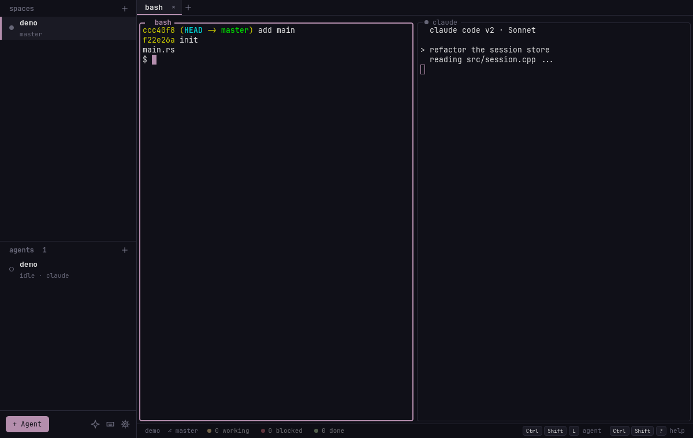
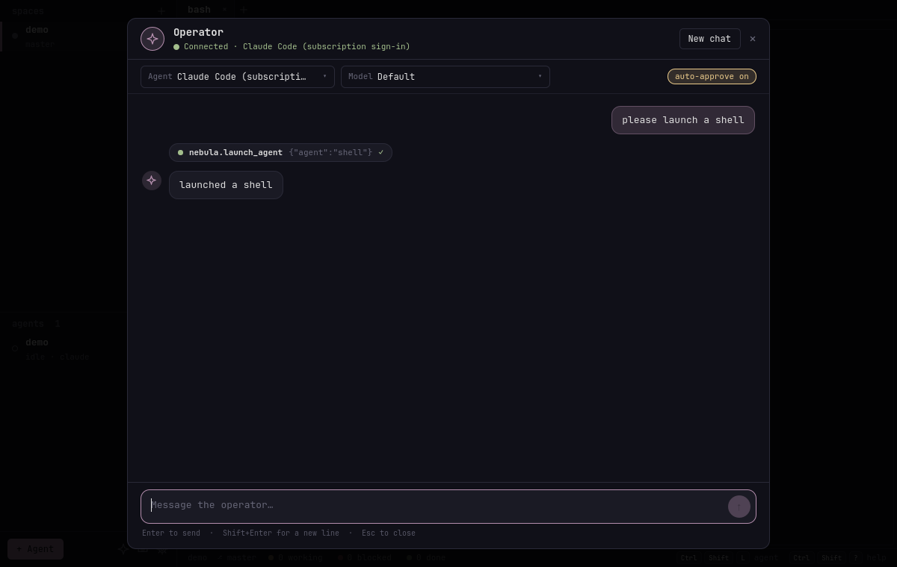

# Using nebula

Everyday use: keys, mouse, sessions, settings and files. Back to the [README](../README.md).

| Operator chat | Settings |
|---|---|
|  |  |

## Getting started

1. Run `nebula`. On first launch a short **setup wizard** picks your font size, detects the agent CLIs on your machine, optionally saves an API key, and offers to install the state hooks. Reopen it any time from Settings > *Setup wizard*.
2. Press `Ctrl+Shift+L` to launch an agent (claude, codex, opencode, ...), optionally in its own git worktree. Its status shows up in the sidebar and the status bar; `Ctrl+Shift+A` jumps to whichever agent needs you.
3. Press `Ctrl+Shift+I` to open the operator chat and ask for things like *"launch claude and codex on the flaky test, each in a worktree"*.
4. Close the window whenever you like: shells and agents keep running and are reattached next time.

## Keybindings

No prefix key; `Ctrl+Shift+?` shows them in the app.

| Keys | Action |
|---|---|
| `Ctrl+Shift+D` / `Ctrl+Shift+E` | split right / down |
| `Ctrl+Shift+W` / `Ctrl+Shift+Z` | close / zoom pane |
| `Ctrl+Shift+Arrows` | focus pane |
| `Ctrl+Shift+T`, `Ctrl+Tab`, `Ctrl+Shift+Tab`, `Ctrl+PgUp/PgDn`, `Alt+1-9` | new tab, next/prev, jump |
| `Ctrl+Shift+N` / `Ctrl+Shift+Q` / `Ctrl+Shift+R` | new / close / rename space |
| `Ctrl+Shift+PgUp/PgDn`, `Ctrl+Alt+1-9` | prev/next space, jump |
| `Ctrl+Shift+A` | jump to the agent that is blocked / done |
| `Ctrl+Shift+L` / `Ctrl+Shift+M` | launch an agent / broadcast a prompt |
| `Ctrl+Shift+I` | operator (built-in AI that runs nebula) |
| `Ctrl+Shift+O` | show / hide agent views (the modal) |
| `Ctrl+Shift+B` / `Ctrl+,` | toggle sidebar / settings |
| `Ctrl++` `Ctrl+-` `Ctrl+0` / `Ctrl+wheel` | font size |
| `Ctrl+Shift+C/V`, `Shift+PgUp/PgDn` | copy/paste, scrollback |

All `Ctrl+Shift+…` combos are unused by terminal programs, so nothing is stolen from your shell/TUIs. Override in `~/.config/nebula/keys.conf`:

    Ctrl+Shift+D = split-right
    Alt+Left = focus-left
    Ctrl+Shift+Q = none

Actions: split-right split-down close-pane zoom-pane focus-left/right/up/down new-tab close-tab next-tab prev-tab goto-tab:N new-space rename-space close-space next-space prev-space goto-space:N next-attention toggle-views toggle-sidebar open-settings launch-agent operator broadcast toggle-help font-larger font-smaller font-reset.

## Explorer

`Ctrl+Shift+F` (or the files button in the sidebar footer) shows the current space's project, its git work tree or its folder, as a tree between the sidebar and the panes; drag its edge to resize it. Folders open and close, files git ignores are dimmed, the file in the focused editor is marked, and the tree follows the disk (files made by agents, builds or the shell show up on their own).

A click opens a file and keeps the keyboard in the tree; `Enter` or a double click opens it and moves into it. `.neb` and Markdown open as views (with an *edit* button), anything else in the editor, reusing the tab's editor when it has no unsaved changes. Arrows move and open folders, `F2` renames, `Delete` moves to the trash (after a confirmation). The header and the right-click menu create files and folders (`src/new.rs` creates the folder too), rename, trash, copy a path or open a terminal in a folder; the eye shows hidden files.

## Editor

A native editor pane for code and text, drawn like the terminal (no web engine), next to your shells and agents.

- **Open**: `nebula path/to/file` (any text file; `.neb` and Markdown open as views, with an *edit* button), `Ctrl+Shift+P` (quick open: type part of a path; a path that does not exist yet is created on save), or `nebula ctl editor.open file=PATH [line=N] [where=right|down|tab]`. Opening a file that is already open focuses it.
- **Keys**: `Ctrl+S` save (`Ctrl+Shift+S` save as), `Ctrl+Z` / `Ctrl+Y` undo / redo (typing undoes word by word), `Ctrl+X/C/V` (with nothing selected: the whole line), `Ctrl+A`, `Ctrl+F` find, `Ctrl+H` replace, `F3` / `Shift+F3` next / previous, `Ctrl+G` go to line (`120` or `120:8`), `Ctrl+/` toggle comment, `Ctrl+D` duplicate line or selection, `Ctrl+L` select line, `Ctrl+Shift+K` delete line, `Alt+Up/Down` move lines, `Tab` / `Shift+Tab` indent / outdent, `Home` (first non-blank, again: column 0), `Ctrl+Left/Right` by word, `Ctrl+Backspace/Delete` delete a word. Enter keeps the indentation and adds a level after `{ [ (` (and `:` in Python and YAML); brackets and quotes close as you type them and typing the closer steps over it.
- **Mouse**: click, drag to select (scrolls at the edges), double-click a word, triple-click or click the line numbers for lines, `Shift+click` extends, middle-click pastes the primary selection, wheel scrolls (`Shift` sideways, `Ctrl` zooms the font), the scrollbar drags.
- **Find bar**: match count, case (`Aa`), whole word (`W`) and regular expressions (`.*`, replacement with `\1`); matches are marked in the text.
- **Colours** for C, C++, Rust, Python, JavaScript/TypeScript, QML, Go, Java/Kotlin/C#, shell, JSON, YAML, TOML, INI, Markdown and `.neb`, CMake, Make/just, Lua, SQL, CSS and HTML/XML, recomputed only from an edit down, so large files stay fast.
- **Files** are written atomically, keeping their permissions, symlinks, line endings (LF or CRLF), BOM and final newline; binary files and files over 64 MB are refused. A file changed on disk reloads by itself, or, with unsaved changes, asks whether to reload or keep yours.
- **Nothing is lost**: unsaved text is kept with the session, so closing the window, a reboot or Kill all & quit bring it back; closing a modified editor (or its tab or space) asks to save, discard or cancel.
- **`.neb` and Markdown**: the *edit* button of a view opens its file next to it, and the *preview* button of an editor shows the document next to the editor; either way the view follows what you type, before you save.
- **Automation**: `editor.list`, `editor.get [pane=ID] [text=true]`, `editor.save`, and `pane.send_text` / `pane.send_keys` type into an editor; `pane.close` refuses unsaved changes without `force=true`.

## Tray

Closing the window keeps nebula running in the system tray (the StatusNotifierItem tray of Waybar, Quickshell, KDE, GNOME with the AppIndicator extension, or the Windows notification area): agents keep notifying, and the tray icon, or starting `nebula` again, brings the window back as it was. The tray menu also quits (shells keep running in the host) or kills everything. Settings > General > *Keep running in the tray* turns it off; without a tray, closing quits the window as before.

## Mouse

Click a pane to focus; drag dividers (double-click resets to 50%); drag the sidebar edge to resize it. Double-click selects a word, triple-click a line, drag selects (auto-copies), middle-click pastes, `Ctrl+click` opens a link, right-click opens a context menu (copy/paste/split/zoom/close/settings). Hover a pane for split/zoom/close buttons; tabs and spaces have hover close buttons; double-click a space to rename. The scrollbar appears while scrolled back and is draggable.

## Sessions

Panes are owned by a small background daemon (`nebula --host`, started automatically), not by the window. Close the window, crash the GUI or `kill -9` it: shells and their jobs keep running. Next launch reattaches every pane, replaying up to 2 MB of output per pane (including alt-screen/mouse modes) so scrollback and TUIs come back as you left them.

The layout (spaces, tabs, splits, ratios, names, focus, zoom) is saved continuously to `session.json` in the state dir, together with what each pane is running. If the host is gone too (a reboot, or `kill-session`), the layout is rebuilt with fresh shells in the same directories and each pane gets its program back, under a `[nebula] session restored` note:

- **Agents** reopen the exact conversation they were in, with the flags they were started with and without their initial prompt: `claude --dangerously-skip-permissions --resume <id>`, `opencode --session <id>`, `codex resume <id>`. The id comes from the agent's hooks (install them in Settings > Integrations; Claude Code's need no reinstall, opencode's and Codex's do) or from its own arguments; without one it falls back to `--continue` / `resume --last`.
- **Interactive programs** (editors, pagers, `htop`/`btop`, file managers, `lazygit`, database shells, REPLs without a script, `ssh`, `tail -f`) start again by themselves.
- **Anything else** (a build, a script) is typed at the prompt and waits for Enter. It stays remembered until you do something in that pane, so a second reboot keeps it.

Settings > Session > *Restore programs* changes this: start them again (default), type every command at the prompt, or restore only the shells. Panes that survive in the host but not in the layout show up in a `recovered` space.

Closing a pane/tab/space kills its shells. `kill-session` (the power button, Settings, or `nebula ctl action.run action=kill-session`) terminates everything and quits, keeping the session for the next start; `discard-session` also forgets it, so nebula starts empty. Tests: `just e2e-persist`.

## Settings

Gear icon in the sidebar footer, or `Ctrl+,`. Stored in `~/.config/nebula/settings.json` (font family/size, sidebar width, shell, scrollback, copy-on-select, link clicks, focus-follows-mouse, notifications). Also scriptable: `nebula ctl settings.get`, `nebula ctl settings.set key=fontSize value=12`.

## Files and configuration

On Windows, `~/.config/nebula` is `%APPDATA%\nebula` and `~/.local/state/nebula` is `%LOCALAPPDATA%\nebula\state`.

| Path | What |
|---|---|
| `~/.config/nebula/settings.json` | Settings (also editable in the app; `nebula ctl settings.get/set`) |
| `~/.config/nebula/keys.conf` | Key overrides, one `Ctrl+Shift+D = split-right` per line (`none` unbinds) |
| `~/.config/nebula/agents.conf` | Extra launcher agents, one `name = command` per line (`mytool = mytool --fast`) |
| `~/.config/nebula/secrets.json` | API keys, only when no system keyring is available (mode 0600); on Windows the Credential Manager is used |
| `~/.local/state/nebula/session.json` | Layout of spaces, tabs and splits |
| `~/.local/state/nebula/operator-history.json` | Operator chat history (display only) |
| `~/.local/state/nebula/views/` | Inline content of open views |
| `$XDG_RUNTIME_DIR/nebula.sock` | Automation socket (`NEBULA_SOCKET` overrides; `NEBULA_STATE_DIR` moves the state dir); on Windows the named pipe `\\.\pipe\nebula-<user>` |

## Input methods

The terminal item implements Qt's input-method protocol (cursor rectangle, preedit rendering at the cursor, commit), so fcitx5/ibus composition works.
