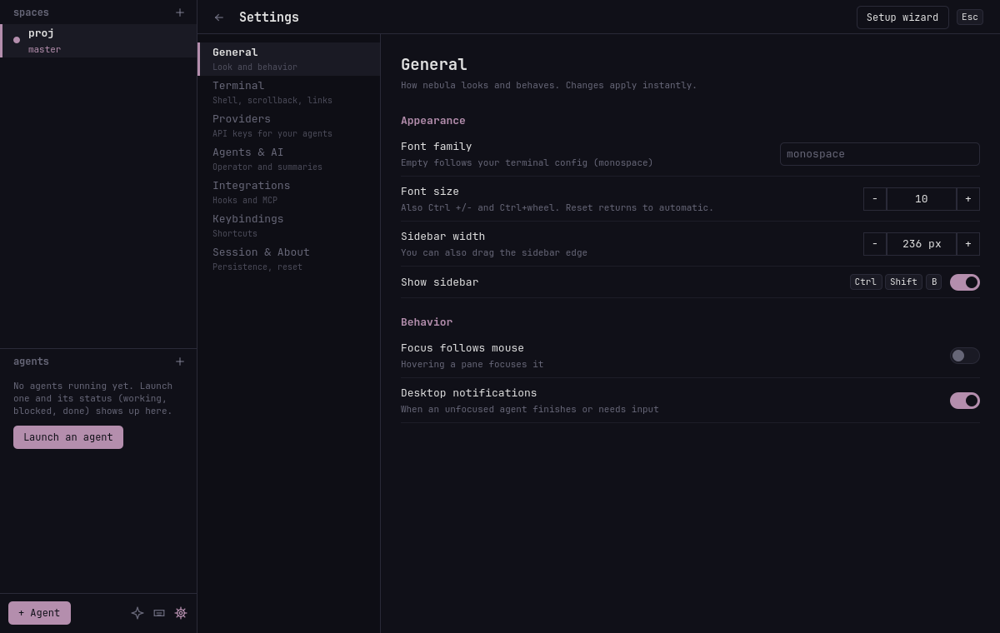

# Using nebula

Everyday use: keys, mouse, sessions, settings and files. Back to the [README](../README.md).

| Operator chat | Settings |
|---|---|
|  |  |

## Getting started

1. Run `nebula`. On first launch a short **setup wizard** picks your font size, detects the agent CLIs on your machine, optionally saves an API key, and offers to install the state hooks. Reopen it any time from Settings > *Setup wizard*.
2. Press `Ctrl+Shift+L` to launch an agent (claude, codex, opencode, ...), optionally in its own git worktree. Its status shows up in the sidebar and the status bar; `Ctrl+Shift+A` jumps to whichever agent needs you.
3. Press `Ctrl+Shift+I` to open the operator chat and ask for things like *"launch claude and codex on the flaky test, each in a worktree"*.
4. Close the window whenever you like: shells and agents keep running and are reattached next time.

## Keybindings

No prefix key; `Ctrl+Shift+?` shows them in the app.

| Keys | Action |
|---|---|
| `Ctrl+Shift+D` / `Ctrl+Shift+E` | split right / down |
| `Ctrl+Shift+W` / `Ctrl+Shift+Z` | close / zoom pane |
| `Ctrl+Shift+Arrows` | focus pane |
| `Ctrl+Shift+T`, `Ctrl+Tab`, `Ctrl+Shift+Tab`, `Ctrl+PgUp/PgDn`, `Alt+1-9` | new tab, next/prev, jump |
| `Ctrl+Shift+N` / `Ctrl+Shift+Q` / `Ctrl+Shift+R` | new / close / rename space |
| `Ctrl+Shift+PgUp/PgDn`, `Ctrl+Alt+1-9` | prev/next space, jump |
| `Ctrl+Shift+A` | jump to the agent that is blocked / done |
| `Ctrl+Shift+L` / `Ctrl+Shift+M` | launch an agent / broadcast a prompt |
| `Ctrl+Shift+I` | operator (built-in AI that runs nebula) |
| `Ctrl+Shift+O` | show / hide agent views (the modal) |
| `Ctrl+Shift+B` / `Ctrl+,` | toggle sidebar / settings |
| `Ctrl++` `Ctrl+-` `Ctrl+0` / `Ctrl+wheel` | font size |
| `Ctrl+Shift+C/V`, `Shift+PgUp/PgDn` | copy/paste, scrollback |

All `Ctrl+Shift+…` combos are unused by terminal programs, so nothing is stolen from your shell/TUIs. Override in `~/.config/nebula/keys.conf`:

    Ctrl+Shift+D = split-right
    Alt+Left = focus-left
    Ctrl+Shift+Q = none

Actions: split-right split-down close-pane zoom-pane focus-left/right/up/down new-tab close-tab next-tab prev-tab goto-tab:N new-space rename-space close-space next-space prev-space goto-space:N next-attention toggle-views toggle-sidebar open-settings launch-agent operator broadcast toggle-help font-larger font-smaller font-reset.

## Mouse

Click a pane to focus; drag dividers (double-click resets to 50%); drag the sidebar edge to resize it. Double-click selects a word, triple-click a line, drag selects (auto-copies), middle-click pastes, `Ctrl+click` opens a link, right-click opens a context menu (copy/paste/split/zoom/close/settings). Hover a pane for split/zoom/close buttons; tabs and spaces have hover close buttons; double-click a space to rename. The scrollbar appears while scrolled back and is draggable.

## Sessions

Panes are owned by a small background daemon (`nebula --host`, started automatically), not by the window. Close the window, crash the GUI or `kill -9` it: shells and their jobs keep running. Next launch reattaches every pane, replaying up to 2 MB of output per pane (including alt-screen/mouse modes) so scrollback and TUIs come back as you left them.

The layout (spaces, tabs, splits, ratios, names, focus, zoom) is saved continuously to `session.json` in the state dir, together with what each pane is running. If the host is gone too (a reboot, or `kill-session`), the layout is rebuilt with fresh shells in the same directories and each pane gets its program back, under a `[nebula] session restored` note:

- **Agents** reopen the exact conversation they were in, with the flags they were started with and without their initial prompt: `claude --dangerously-skip-permissions --resume <id>`, `opencode --session <id>`, `codex resume <id>`. The id comes from the agent's hooks (install them in Settings > Integrations; Claude Code's need no reinstall, opencode's and Codex's do) or from its own arguments; without one it falls back to `--continue` / `resume --last`.
- **Interactive programs** (editors, pagers, `htop`/`btop`, file managers, `lazygit`, database shells, REPLs without a script, `ssh`, `tail -f`) start again by themselves.
- **Anything else** (a build, a script) is typed at the prompt and waits for Enter. It stays remembered until you do something in that pane, so a second reboot keeps it.

Settings > Session > *Restore programs* changes this: start them again (default), type every command at the prompt, or restore only the shells. Panes that survive in the host but not in the layout show up in a `recovered` space.

Closing a pane/tab/space kills its shells. `kill-session` (the power button, Settings, or `nebula ctl action.run action=kill-session`) terminates everything and quits, keeping the session for the next start; `discard-session` also forgets it, so nebula starts empty. Tests: `just e2e-persist`.

## Settings

Gear icon in the sidebar footer, or `Ctrl+,`. Stored in `~/.config/nebula/settings.json` (font family/size, sidebar width, shell, scrollback, copy-on-select, link clicks, focus-follows-mouse, notifications). Also scriptable: `nebula ctl settings.get`, `nebula ctl settings.set key=fontSize value=12`.

## Files and configuration

On Windows, `~/.config/nebula` is `%APPDATA%\nebula` and `~/.local/state/nebula` is `%LOCALAPPDATA%\nebula\state`.

| Path | What |
|---|---|
| `~/.config/nebula/settings.json` | Settings (also editable in the app; `nebula ctl settings.get/set`) |
| `~/.config/nebula/keys.conf` | Key overrides, one `Ctrl+Shift+D = split-right` per line (`none` unbinds) |
| `~/.config/nebula/agents.conf` | Extra launcher agents, one `name = command` per line (`mytool = mytool --fast`) |
| `~/.config/nebula/secrets.json` | API keys, only when no system keyring is available (mode 0600); on Windows the Credential Manager is used |
| `~/.local/state/nebula/session.json` | Layout of spaces, tabs and splits |
| `~/.local/state/nebula/operator-history.json` | Operator chat history (display only) |
| `~/.local/state/nebula/views/` | Inline content of open views |
| `$XDG_RUNTIME_DIR/nebula.sock` | Automation socket (`NEBULA_SOCKET` overrides; `NEBULA_STATE_DIR` moves the state dir); on Windows the named pipe `\\.\pipe\nebula-<user>` |

## Input methods

The terminal item implements Qt's input-method protocol (cursor rectangle, preedit rendering at the cursor, commit), so fcitx5/ibus composition works.
